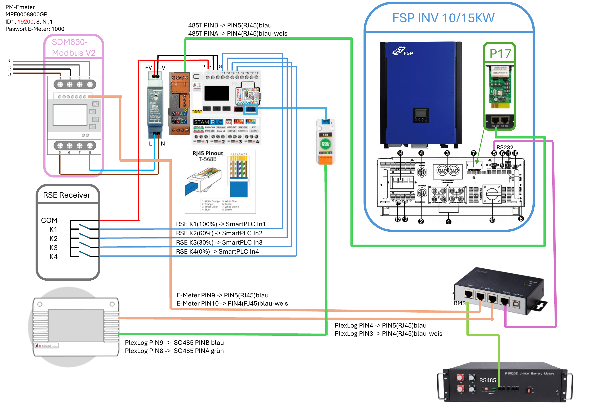
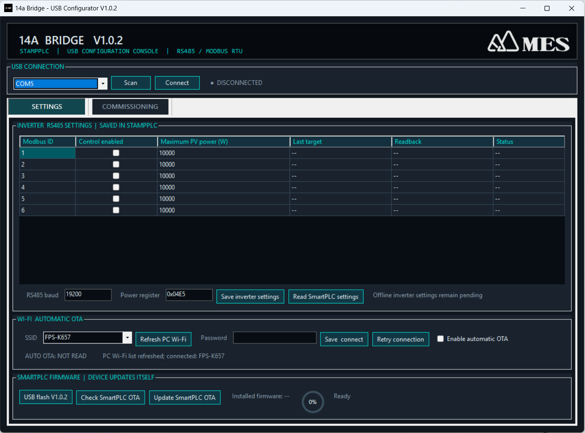
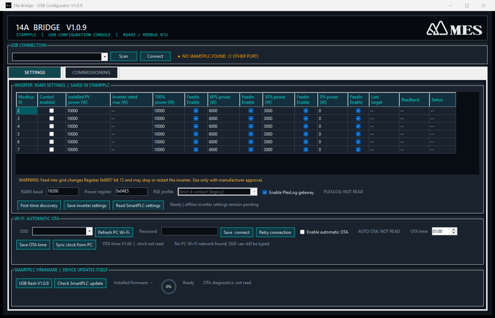
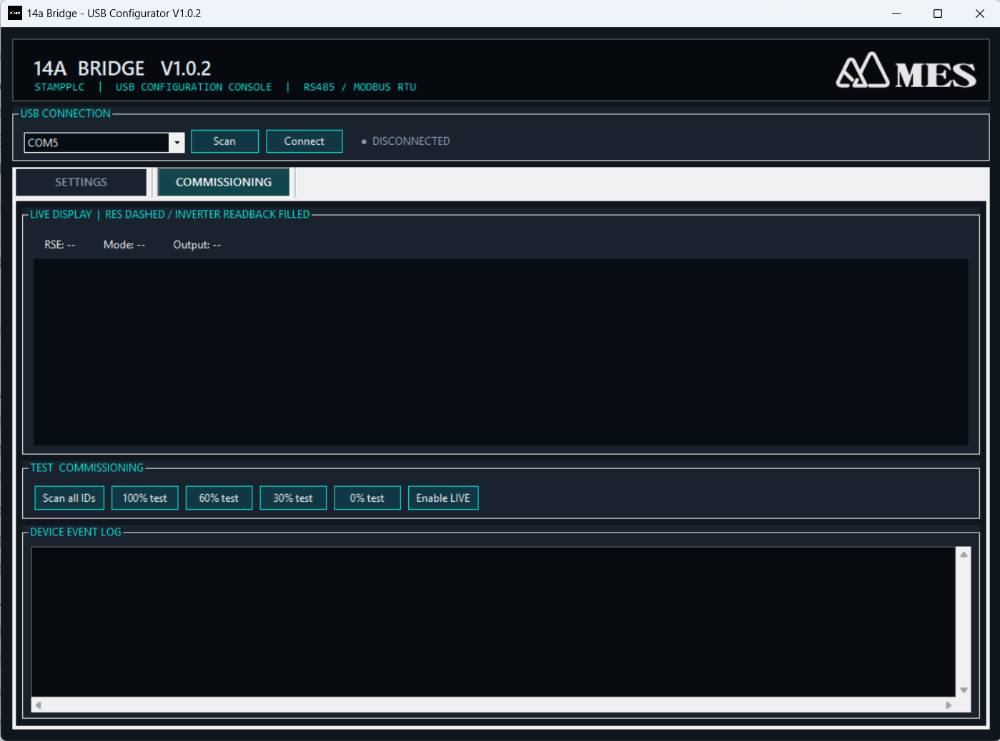
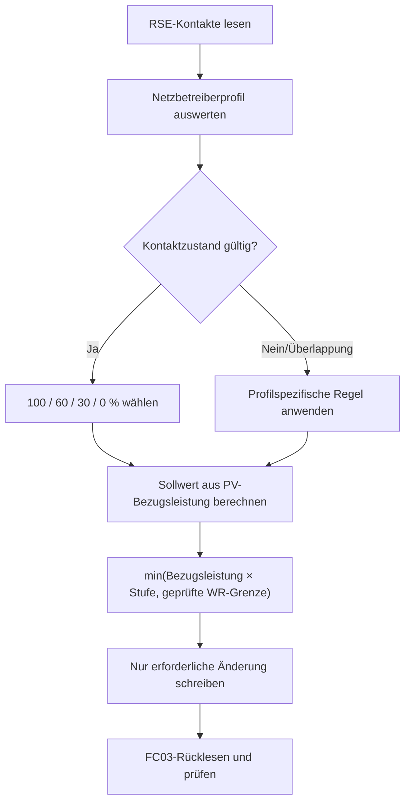

# 14a Bridge

**Deutsch (Standard)** · [English](README.en.md) · [繁體中文](README.zh-TW.md)

Firmware und Windows-USB-Konfigurator für den Einsatz einer M5Stack StampPLC
als Brücke zwischen Rundsteuerempfänger (RSE) und bis zu sechs
Modbus-RTU-Wechselrichtern (IDs 2–7).

Die StampPLC liest potenzialfreie RSE-Relaiskontakte, berechnet für jeden
Wechselrichter den zulässigen Einspeisewert und prüft jede Änderung durch
FC03-Rücklesen. Unveränderte Sollwerte werden nicht ständig neu geschrieben.

> **Geltungsbereich:** Das Gerät dient der Wirkleistungsbegrenzung von
> PV-Erzeugungsanlagen gemäß EEG und den Anschlussregeln des zuständigen
> Netzbetreibers. EnWG §14a betrifft überwiegend steuerbare
> Verbrauchseinrichtungen. Diese Software ersetzt weder die schriftlichen
> Vorgaben des Netzbetreibers noch Abnahme oder Zertifizierung.

[Neueste Version herunterladen](https://github.com/tatsuo25103/14a-bridge/releases/latest)
· [V1.0.9 Versionshinweise](stamplc_14a_bridge/docs/RELEASE_NOTES_V1.0.9.de.md)
· [Ausführliche technische Referenz](stamplc_14a_bridge/README.md)

## 1. Installation

### 1.1 Verifizierte kompatible Geräte

- FSP PowerManager Hybrid 10 kW
- FSP PowerManager Hybrid 15 kW

> [!IMPORTANT]
> Vor der Inbetriebnahme müssen mindestens die folgenden Geräte-Firmwarestände
> installiert sein. Neuere Versionen sind zulässig.

| Gerät | Erforderliche Mindestversion |
|---|---|
| FSP PowerManager Hybrid 10 kW | `U1: 260226` · `U2: 251229` |
| FSP PowerManager Hybrid 15 kW | `U1: 250819` · `U2: 250703` |
| DualBox | `04.4G` |
| P17-Karte | `17G` |

### 1.2 Windows-Anwendung installieren

1. `14a_Bridge_Setup_V1.0.9.exe` aus den
   [GitHub Releases](https://github.com/tatsuo25103/14a-bridge/releases/latest)
   laden.
2. Setup starten und optional die Desktop-Verknüpfung anlegen.
3. StampPLC per USB-C anschließen.
4. **14a Bridge – USB Configurator** starten.
5. **Scan** wählen. Eine erkannte StampPLC wird automatisch verbunden;
   mehrere Geräte bleiben in der Auswahlliste verfügbar.

### 1.3 Verdrahtung



[Verdrahtungsplan als PDF herunterladen](stamplc_14a_bridge/docs/user_manual_assets/14a_bridge_wiring.pdf)

> [!CAUTION]
> **OPTIONALE PLEXLOG-FUNKTION: 1 PlexLog benötigt 1 eigene SmartPLC.** Das
> Gateway erst aktivieren, nachdem genau dieses PlexLog über PORT.C mit der
> SmartPLC verbunden wurde. Ohne PlexLog bleibt **Enable PlexLog gateway** aus.

> [!IMPORTANT]
> Dieser Plan ersetzt die frühere vereinfachte Zeichnung. Er zeigt auch die
> PlexLog-, Dual-ModBus-Box-, Zähler-, Batterie- und P17-Verbindungen. Vor dem
> Einschalten jede A/B- und RJ45-Pinbelegung am realen Gerät kontrollieren.

#### Versorgung und RSE-Eingänge

| Quelle | Ziel | Funktion |
|---|---|---|
| 12-V-Netzteil `+V` | StampPLC `VIN` und RSE-Empfänger `COM` | Versorgung / gemeinsames Relaissignal |
| 12-V-Netzteil `-V` | StampPLC `GND` und `COM` | Versorgungsrückleiter und DI-Bezug |
| RSE `K1 / K2 / K3 / K4` | StampPLC `IN1 / IN2 / IN3 / IN4` | `100 % / 60 % / 30 % / 0 %` |

Nur **potenzialfreie** RSE-Kontakte direkt anschließen. Niemals geschaltete
230 V auf einen 5–36-V-DC-Eingang legen. Kontaktzuordnung und gemeinsamer Bezug
müssen dem ausgewählten RSE-Profil und den aktuellen Netzbetreiberunterlagen
entsprechen.

#### Wechselrichter-, P17- und PlexLog-Kommunikation

PlexLog und SmartPLC dürfen **nicht parallel als zwei Master** am P17-Bus
liegen. Der SmartPLC bildet deshalb die kontrollierte Brücke zwischen zwei
getrennten Segmenten:

1. **PlexLog-Wechselrichterport → ISO485-Wandler → StampPLC PORT.C**
2. **StampPLC PWR485 → P17-Karte → Wechselrichter IDs 2–7**

| Verbindung | Pinbelegung laut Plan |
|---|---|
| PlexLog Wechselrichterport | Pin 9 (blau) → ISO485 `B`; Pin 8 (grün) → ISO485 `A` |
| ISO485 UART-Seite | `RO` → PORT.C `GPIO4/RX`; `DI` → PORT.C `GPIO5/TX`; 5 V/GND nach Wandlerbeschriftung |
| StampPLC PWR485 → P17-RJ45 | `B` → Pin 5 (blau); `A` → Pin 4 (blau/weiß) |

Für PORT.C ist ein RS485-Wandler mit **automatischer Richtungsumschaltung**
erforderlich. Die frühere direkte PlexLog-Verbindung zum P17-Bus vollständig
entfernen. Es gibt kein Bypass-Relais: Bei stromloser SmartPLC oder
abgeschaltetem Gateway zeigt PlexLog die Wechselrichterkommunikation als
unterbrochen an.

#### Zähler und Dual ModBus Box

Der PlexLog-Zählerkanal wird gemäß neuem Plan über die Dual ModBus Box geführt;
er wird nicht an PORT.C angeschlossen.

| Verbindung | Pinbelegung laut Plan |
|---|---|
| PM-Emeter → Dual ModBus Box | E-Meter Pin 9 → RJ45 Pin 5 (blau); Pin 10 → RJ45 Pin 4 (blau/weiß) |
| PlexLog Zählerkanal → Dual ModBus Box | PlexLog Pin 4 → RJ45 Pin 5 (blau); Pin 3 → RJ45 Pin 4 (blau/weiß) |
| Zählerparameter | ID `1`, `19200`, `8N1`; Gerätepasswort `1000` |
| Weitere Box-Verbindungen | BMS-Port zur Batterie und RS232 zum Wechselrichter wie im Plan gezeigt |

### 1.4 Erstinbetriebnahme

1. Bei neuer StampPLC unter **Settings** mit **USB flash V1.0.9** Bootloader,
   OTA-Partitionen und Firmware installieren. Versorgung nicht unterbrechen.
2. **Read SmartPLC settings** ausführen.
3. RSE-Profil und RS485 (`19200`, Register `0x04E5` für die geprüften
   FSP-Geräte) einstellen.
4. Für IDs 2–7 die gewünschten **Control enabled**-Felder markieren.
5. Die installierte PV-/Bezugsleistung eintragen. Sie darf größer als die
   Wechselrichter-Nennleistung sein.
6. Wechselrichtergrenze prüfen und **Save inverter settings** wählen.
7. Unter **Commissioning** 100/60/30/0 % beaufsichtigt prüfen.
8. Mit **Enable LIVE** auf den realen RSE zurückkehren.

Wenn IDs oder Nennleistungen unbekannt sind, darf **First-time discovery** nur
bei physischem LIVE 100 % oder vor Montage des RSE verwendet werden. Der Scan
ist lesend und speichert erst nach ausdrücklichem **Save inverter settings**.

## 2. Bedienung

### 2.1 Settings



| Bedienelement | Funktion |
|---|---|
| **Scan** | Prüft serielle Ports mit lesender Geräteidentifikation. Fremde Ports werden ignoriert. |
| **First-time discovery** | Lesender Scan der IDs 2–7; übernimmt gefundene Nennwerte vorläufig in die Tabelle. |
| **Save inverter settings** | Speichert IDs, PV-Bezugsleistung, geprüfte Wechselrichtergrenze, RS485 und RSE-Profil. Offline-Geräte bleiben `PENDING`; Eingaben gehen nicht verloren. |
| **Read SmartPLC settings** | Liest die vollständige gespeicherte Konfiguration und den Status neu ein. |
| **Enable PlexLog gateway** | Optionale PORT.C-Weiterleitung. Nur einschalten, wenn ein PlexLog physisch mit genau dieser SmartPLC verbunden ist; andernfalls ausgeschaltet lassen. |
| **Refresh PC Wi-Fi** | Aktualisiert die unter Windows verfügbaren WLAN-Profile. Manuelle SSID-Eingabe bleibt möglich. |
| **Save connect** | Speichert WLAN-Zugangsdaten in der StampPLC und verbindet. |
| **Retry connection** | Verwendet die gespeicherten Zugangsdaten erneut. |
| **Enable automatic OTA** | Aktiviert die geplante Firmwareprüfung der StampPLC. |
| **Save OTA time** | Setzt den Beginn des täglichen 60-Minuten-Wartungsfensters; Standard `01:00` Europe/Berlin. |
| **Sync clock from PC** | Stellt die RTC; bei WLAN erfolgt zusätzlich tägliche NTP-Synchronisation. |
| **USB flash V1.0.9** | Installiert das mitgelieferte Firmwarepaket mit Fortschritt und Schreibprüfung. |
| **Check SmartPLC update** | Prüft signierte SmartPLC-Updates; bei neuer Version folgt eine Bestätigungsfrage. |

#### PlexLog-Gateway in der PC-Anwendung aktivieren



*Das Bild zeigt den aktivierten Zustand einer Anlage mit PlexLog; ohne PlexLog
bleibt das Kontrollkästchen leer.*

1. SmartPLC per USB verbinden und **Scan** wählen.
2. Unter **Settings** zuerst **Read SmartPLC settings** wählen.
3. Nur wenn ein PlexLog physisch mit dieser SmartPLC verbunden ist,
   **Enable PlexLog gateway** markieren. Die Einstellung wird sofort dauerhaft
   gespeichert.
4. Warten, bis rechts daneben `PLEXLOG: ON` erscheint. `NOT READ` bedeutet nur,
   dass der Status noch nicht von einer verbundenen SmartPLC gelesen wurde.
5. Ohne PlexLog die Option ausgeschaltet lassen. Eine SmartPLC darf nur das ihr
   fest zugeordnete PlexLog bedienen (`1 PlexLog : 1 SmartPLC`).

Nach dem Aktivieren muss PlexLog den Wechselrichter wieder erreichen. Ist die
SmartPLC stromlos, PORT.C falsch verdrahtet oder das Gateway ausgeschaltet,
meldet PlexLog absichtlich eine unterbrochene Wechselrichterkommunikation.

### 2.2 Commissioning



| Bedienelement | Funktion |
|---|---|
| **100% / 60% / 30% / 0% test** | Temporärer, beaufsichtigter Test. TEST darf eine strengere physische RSE-Vorgabe nicht aufheben und endet nach fünf Minuten. |
| **Enable LIVE** | Beendet TEST sofort und übernimmt wieder den realen RSE-Eingang. |
| **Live display** | Gestrichelte Linie = RSE-Sollwert; Flüssigkeitsfüllung = bestätigter Istwert; roter Rahmen = qualifizierter Fehler. |
| **Device event log** | Zeigt Befehle, Rücklesewerte, begrenzte Wiederholungen, Erholung, OTA und Diagnose. |

Am LCD bedeutet **LIVE** grün, **TEST** gelb und **OTA** blau. Fehlerhafte
Wechselrichter werden vollständig rot dargestellt. Die Firmware liest
regelmäßig nur den Status; sie schreibt nicht fortlaufend unveränderte Werte.

## 3. Steuerlogik



### 3.1 Leistungsberechnung

```text
Sollwert W = min(PV-/Steuerungs-Bezugsleistung W × RSE-Prozent,
                 geprüfte Wechselrichter-Nennleistung W)
```

Beispiel: 18 kW PV an einem 15-kW-Wechselrichter:

| RSE | Berechnung | Sollwert |
|---:|---:|---:|
| 100 % | 18.000 W | 15.000 W |
| 60 % | 10.800 W | 10.800 W |
| 30 % | 5.400 W | 5.400 W |
| 0 % | 0 W | 0 W |

### 3.2 RSE-Profile

| Profil | Keine Kontakte | Mehrere Kontakte |
|---|---|---|
| **Strict 4-contact (Standard)** | Ungültig, Ausgang unverändert | Ungültig, Ausgang unverändert |
| **Westnetz 4-contact** | 100 % | K1 gibt 100 % frei; sonst stärkste Reduzierung |
| **EWE 4-contact (hold last)** | Letzten gültigen Wert halten | Letzten gültigen Wert halten |
| **VDE FNN / Netze BW 3-contact** | 100 % | Stärkste Reduzierung und Warnung; DI1 muss inaktiv sein |

Das Profil darf nicht durch Ausprobieren gewählt werden. Maßgeblich sind die
schriftlichen Vorgaben des zuständigen Netzbetreibers.

### 3.3 RSE-Empfänger und Kompatibilität

Ein RSE-Profil beschreibt die **Kontaktbelegung und Auswertelogik**, nicht ein
festes Fabrikat. Programmierbare Rundsteuerempfänger desselben Typs können je
nach Netzbetreiber unterschiedlich parametriert sein. Deshalb müssen vor der
Inbetriebnahme immer Typenschild, Parametrierung, Klemmenplan und Kontakttabelle
des konkreten Standorts geprüft werden.

| RSE-Profil | Zugeordnete Hersteller / Typen | Bewertung |
|---|---|---|
| **Strict 4-contact** | Kein exklusiver Gerätetyp. Möglich sind z. B. Langmatz **EK893 / EK893A**, Landis+Gyr **FTY263 / FTU263** sowie Swistec **SRE-6 / SRvario**, sofern sie auf K1=100 %, K2=60 %, K3=30 %, K4=0 % mit genau einem aktiven Kontakt parametriert sind. | Bedingt kompatibel; Parametrierung und Verdrahtung müssen nachgewiesen werden. |
| **Westnetz 4-contact** | Ein für Westnetz parametrierter FRE mit vier potenzialfreien Ausgängen K1–K4. Westnetz legt die Funktionen 100/60/30/0 % fest, schreibt in den veröffentlichten Unterlagen aber keinen einzigen Hersteller oder Typ verbindlich vor. | Die Westnetz-Kontaktbelegung ist dokumentiert; das konkrete Gerät ist standortabhängig. |
| **EWE 4-contact (hold last)** | EWE nennt Landis+Gyr **RCR161**, System Edf, je nach Netzgebiet 175 oder 210 Hz. | Der Gerätetyp ist dokumentiert, die Übereinstimmung seiner jeweiligen Parametrierung mit der hier implementierten Vierstufen-„hold last“-Logik ist jedoch **nicht bestätigt**. |
| **VDE FNN / Netze BW 3-contact** | Netze BW nennt Langmatz **EK893 / EK893A** mit drei Reduktionskontakten: kein Kontakt=100 %, K2=60 %, K3=30 %, K4=0 %. | Dokumentierte logische Übereinstimmung mit diesem Profil. |

Quellen: [Westnetz TAB Niederspannung](https://www.westnetz.de/content/dam/revu-global/westnetz/documents/bauen/ihr-weg-zum-netzanschluss/niederspannung/tab-niederspannung-01022025.pdf),
[Westnetz Inbetriebnahmenachweis](https://kundendaten.westnetz.de/Bestaetigung-Einspeisemanagement_Nachweis-FRE.pdf),
[EWE Technische Anforderungen](https://www.ewe-netz.de/-/media/ewe-netz/downloads/2023_eisman_dokument_25-100_kw.pdf),
[Netze BW Technische Mindestanforderungen](https://assets.cdn.netze-bw.de/xytfb1vrn7of/uSbS6i373cDrgXvZ1RTb3/1ea3ee4dfe27e1ec25019fd9d9cbef82/technische-mindestanforderungen-zur-steuerung-elektrischer-anlagen.pdf)
und [VDE FNN Schnittstellenhinweis](https://www.vde.com/resource/blob/2352664/6599b9aad89846ca5f668ad5f4fc9e64/vde-fnn-hinweis-schnittstellen-steuerungseinrichtung-data.pdf).
Herstellerinformationen zu programmierbaren Relaisausgängen:
[Landis+Gyr FTY263](https://www.landisgyr.com/webfoo/wp-content/uploads/product-files/LandisGyr_FTY263_TechData_EN1.pdf),
[Landis+Gyr FTU263](https://www.landisgyr.com/webfoo/wp-content/uploads/product-files/FTU263_Technical_Data_D000041641_b.pdf)
und [Swistec SRE-6](https://swistec.ch/wp-content/uploads/2016/05/SRE-6_deutsch-2.0_swistec_rundsteuerung_empfaenger.pdf).

> **Freigaberegel:** Ein Empfänger darf nur dann in die Liste der verifizierten
> Geräte aufgenommen werden, wenn Netzbetreiber, Hersteller und Typ,
> Parametrierungsstand, Klemmenbelegung und ein dokumentierter Funktionstest
> zusammen vorliegen. Der Modellname allein reicht nicht aus.

## 4. OTA und Wiederherstellung

Automatische OTA-Installation beginnt nur bei gültiger Uhrzeit, im
konfigurierten Wartungsfenster, bei stabilem physischem 100 %, in LIVE, bei
freiem Modbus und wenn alle aktivierten Wechselrichter am Sollwert bestätigt
sind. Diese Bedingungen werden während des Downloads weiter geprüft.

Manifest und Firmware müssen ECDSA-/SHA-256-geprüft sein. Nach Neustart bleibt
RS485 für 15 Sekunden gesperrt, bis der Selbsttest bestanden ist. Bei Fehler
wird automatisch zur vorherigen gültigen Firmware zurückgekehrt; Einstellungen
in NVS bleiben erhalten.

### Lokale Rückkehr zur vorherigen Firmware

Nach erfolgreicher OTA-Prüfung wird die vorherige Partition zusammen mit ihrer
ELF-SHA-256 gespeichert. **A+C fünf Sekunden halten**, B nicht drücken. Das LCD
zeigt einen kreisförmigen Countdown; B bricht ab. Die Rückkehr wird nur bei
stabilem physischem 100 %, LIVE, freiem Modbus und bestätigten Wechselrichtern
ausgeführt. Anschließend wird AUTO OTA deaktiviert, damit die abgelehnte Version
nicht sofort erneut installiert wird.

## 5. Vorschriften und Hinweise

- [EEG §9](https://www.gesetze-im-internet.de/eeg_2014/__9.html): technische
  Möglichkeit zur ferngesteuerten Einspeiseregelung.
- [EEG §3 Nr. 31](https://www.gesetze-im-internet.de/eeg_2014/__3.html):
  Definition der installierten Leistung.
- [VDE FNN Schnittstellenhinweis](https://www.vde.com/resource/blob/2352664/6599b9aad89846ca5f668ad5f4fc9e64/vde-fnn-hinweis-schnittstellen-steuerungseinrichtung-data.pdf):
  Beispiel der Drei-Kontakt-Schnittstelle.

Netzbetreiberprofil, Leistungsbasis, Relaisverdrahtung und Inbetriebnahme sind
für jeden Standort zu dokumentieren und zu bestätigen. Softwarekonformität
allein ist keine elektrische Abnahme oder rechtliche Zertifizierung.

## 6. Versionen

V1.0.9 ergänzt das getrennte PlexLog-Gateway über PORT.C, priorisierte
Bus-Arbitrierung, exakte Lese-Caches und Diagnose je Wechselrichter. PlexLog
und SmartPLC arbeiten dadurch nicht mehr als zwei Master auf demselben
P17-Bus. Details stehen in den
[V1.0.9 Versionshinweisen](stamplc_14a_bridge/docs/RELEASE_NOTES_V1.0.9.de.md).
Frühere Versionen bleiben auf der
[Release-Seite](https://github.com/tatsuo25103/14a-bridge/releases) verfügbar.
